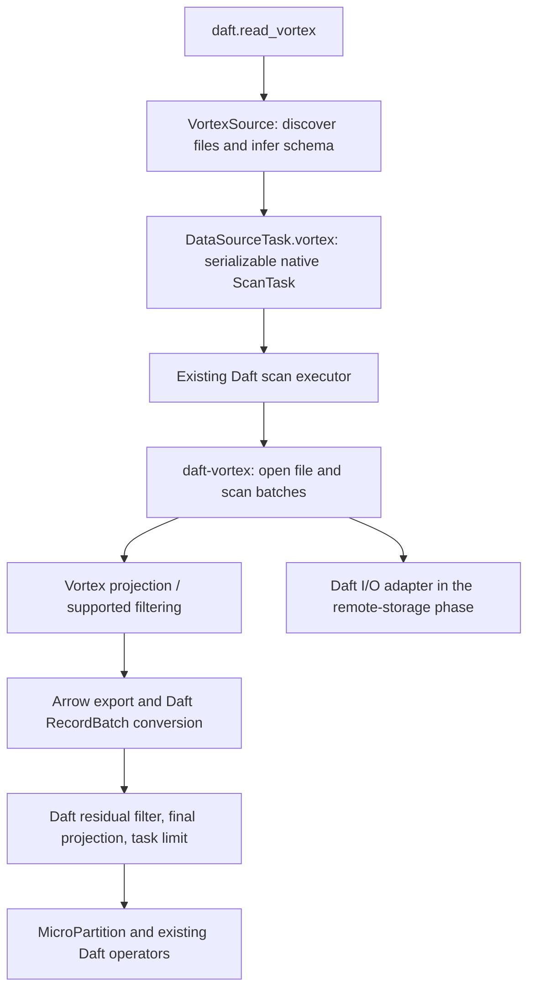

# Vortex read support: design and delivery plan

**Status:** Phases 0, 1, and 2 are complete for the experimental local-reader scope. Phase 2 adds selective scans behind the same default-off `vortex` feature; see its [design](vortex-phase2-design.md) and [validation record](vortex-phase2-results.md). The [Phase 1 validation record](vortex-phase1-results.md) includes the dependency cost accepted for this fork.

Phase 3 is complete for its declared I/O, resource-control, and worker scope, including real HTTP/MinIO/Ray acceptance; see the [plan](vortex-phase3-design.md) and [validation record](vortex-phase3-results.md). Phase 4's benchmark harness, connector documentation, personal-fork CI workflow, and Vortex footer row estimates are implemented. Release evaluation and local/user-terminal acceptance are complete for the [Phase 4 scope](vortex-phase4-design.md); the [results record](vortex-phase4-results.md) includes remaining regressions and measurement limits. GitHub/Linux workflow execution is separately unverified.

**Scope:** `AYUSHNSUT/Daft`; integration branch `poc/vortex-eval`, current implementation branch `poc/vortex-phase4`, review base `poc/vortex-phase3`.

**Design baseline:** `d3cd974150ba93dbbe8efef8370b129538fcee4b`; reviewed October 20, 2026.

**Companion:** [test and benchmark plan](vortex-integration-test-plan.md).

**Current experiment:** [fixture and baseline instructions](../../examples/vortex_eval/README.md), [Phase 1 results](vortex-phase1-results.md), [Phase 2 selective-scan results](vortex-phase2-results.md), [Phase 3 I/O and scheduling validation](vortex-phase3-results.md), [Phase 4 release results](vortex-phase4-results.md), [release benchmark instructions](../../benchmarking/vortex/README.md), and the [experimental connector guide](../connectors/vortex.md).

## Summary

Add an experimental, read-only Vortex connector that feeds Daft's existing execution engine. Start with local files and correct query results, then add projection, conservative predicate pushdown, and remote storage. Evaluate the result against **the same Daft engine reading Parquet**.

The intended implementation is a native Rust reader using the source/task pattern already used by MCAP. A small Python `DataSource` experiment is an optional first step for learning the Vortex API and generating a correctness reference; it is not a second permanent connector.

This is a plan for this personal fork, not an announced upstream feature. It fits the source extensibility and memory-management direction described in Daft's [roadmap](../roadmap.md), without changing that roadmap or assuming those refactors are unfinished.

## Problem and expected benefit

At the design baseline, Daft had no built-in Vortex reader; the Phase 0 reference lives outside the public API. Converting an entire dataset to Parquet or an in-memory Arrow table before giving it to Daft prevents us from evaluating Vortex as a scan source. Phase 1 now provides that native scan boundary for local files.

Vortex supplies file metadata, compressed encodings, scanning, and Arrow export. Daft should continue to own query planning, task scheduling, joins, aggregations, and downstream execution. The integration boundary is a stream of Arrow-compatible batches, not a replacement execution engine.

The hypothesis is that some workloads benefit from cheaper reads, selective column access, and filtering before Arrow materialization. The cost of converting Vortex arrays into Daft batches can offset those benefits. This design does **not** keep Vortex encodings throughout Daft's operators or promise a speedup over Parquet, DataFusion, or Velox. See the [benchmark protocol](vortex-integration-test-plan.md#benchmark-protocol).

## Scope and proposed API

The experimental fork API is available when built with Rust features `python,vortex`:

```python
import daft
from daft import col

df = daft.read_vortex("data/*.vortex", batch_size=131072)
result = df.where(col("value") >= 20).select("id").limit(100)
result.show()
```

The API accepts `path`, optional `io_config`, and `batch_size=131072`. Keyword-only options are `enable_projection_pushdown=True`, `enable_filter_pushdown=True`, `max_concurrent_requests=8`, and `max_in_flight_bytes=67108864`. Phase 3 carries explicit configuration into Daft I/O and serializes the per-reader budgets. See its validation record for remote and worker acceptance. The switches independently disable physical Vortex optimizations for differential testing; Daft still applies the complete filter and final projection.

| Capability | First native milestone | Later phases |
| --- | --- | --- |
| Local files, directories, globs, path lists | Yes; one task per discovered file | Intra-file splits if justified |
| Schema | Read the first file's footer; validate other files before emitting their rows | Explicit schema evolution policy if needed |
| Query semantics | Daft predicates, projection, and exact post-filter task limits | Proven Vortex predicate translation and pruning |
| Data types | Nullable booleans, signed/unsigned integers, floats, UTF-8, binary | Dates/timestamps, decimals, lists, structs after compatibility tests |
| Counts | Scan rows; preserve zero-column batch cardinality | Eligible metadata counts only after separate tests |
| Remote URLs / Ray | Explicitly unsupported until their gates pass | Daft I/O configuration, metrics, serialization, and worker coverage |
| Writes / table formats | Out of scope | No implicit Iceberg, Delta, or Vortex writer support |

A schema-bearing empty file is valid. An empty path list, no matches, corrupt input, unsupported type, or incompatible file schema raises an actionable error containing the path. Do not silently skip files or fall back to another format.

The first native version requires consistent field names, order, and Daft logical types across files. This is deliberately stricter than readers that cast or fill missing columns. Any later schema evolution must happen **before** residual predicates, not only in final batch conformance.

Use Daft's existing path/glob facilities rather than a separate Python glob implementation. Define recursive directory discovery for `*.vortex`, preserve explicit filenames regardless of extension, and deduplicate overlapping inputs. Do not add Hive partition discovery or clustering guarantees in the first milestone.

## Architecture



A **scan task** is a schedulable unit of input work. Initially it describes one file, its schema, and query requirements. A **residual predicate** is a filter that Daft must evaluate after reading a batch because it has not been safely handled by Vortex.

### Reuse the current source path

Follow [`MCAPSource`](../../daft/io/_mcap.py), [`DataSourceTask.mcap`](../../daft/io/source.py), and [`PyDataSourceTask::new_file_task`](../../src/daft-scan/src/python.rs). The Python object plans files; the task factory produces a native `ScanTask`; execution dispatches to a Rust batch stream.

The newer Rust source traits are mid-migration in this checkout. Implementing an arbitrary Rust `DataSourceTask::read()` is insufficient: [`ShimSourceTask`](../../src/daft-scan/src/source.rs) and the [Python wrapper](../../src/daft-scan/src/python/wrappers.rs) currently bridge native tasks through `as_scan_task()`. Use that existing route instead of extending the scheduler as part of this connector.

### Keep query semantics at the boundary

The native reader must honor every predicate present in its scan task. The [generic scan wrapper](../../src/daft-local-execution/src/sources/scan_task.rs) performs schema conformance and partition handling; it does not supply a missing row filter. Other scan paths can absorb filters from the logical plan, so correctness must not depend on an outer filter still being present.

Use the order demonstrated by [`stream_mcap`](../../src/daft-mcap/src/lib.rs):

```text
read required columns -> convert to Daft batch -> evaluate residual filter
-> project final columns -> enforce remaining task limit -> emit
```

Until translation is proven, evaluate the complete task predicate in Daft. After adding Vortex filtering, retaining the complete Daft predicate as a correctness check is acceptable initially. A pushed predicate must never remove a row that Daft would keep.

Columns read must include output columns **and all columns required by residual predicates**. Keep task limits after filtering in Daft. The pinned Vortex 0.88.0 scan builder rejects combining a filter and a limit, even if the filter is fully translated. Revisit Vortex-side limits only for a proven unfiltered path or a separately validated release. The existing executor retains responsibility for the global limit across tasks. [Pinned scan builder](https://github.com/vortex-data/vortex/blob/0.88.0/vortex-layout/src/scan/scan_builder.rs).

The current Python source wrapper advertises `can_absorb_filter/select/limit = false`. Do not flip those flags globally to optimize one connector. Test both direct native task semantics and end-to-end plans, since an outer operator can conceal a broken reader.

Keep `supports_count_pushdown()` false initially. Partition predicates are removed by `new_file_task` because file pruning belongs to the source; do not claim partition fields until that logic exists.

### Arrow, runtime, and ownership

Use Daft's existing [`RecordBatch::try_from(&arrow_array::RecordBatch)`](../../src/daft-recordbatch/src/lib.rs) conversion when Arrow versions unify. It avoids Python/IPC in the native data path, but does not guarantee zero-copy conversion for every type or encoding.

Zero-column batches need an explicit row-count-preserving construction: the ordinary `RecordBatch::from_arrow` path rejects zero arrays. Cover `count_rows()`, literal-only projections, and empty results from the beginning.

Keep Vortex sessions, open handles, and caches in worker-local execution state. Serialize paths/configuration and, later, row ranges; reopen the file on the worker. Use Daft's runtime and native batch streams rather than creating a runtime or thread pool per batch. Dropping a direct reader stream must release its owners and cancel pending asynchronous work; already-running blocking reads may finish. Query-consumer close follows the existing executor finish path, which can await completion and does not establish prompt query cancellation or bounded result buffering.

The current source wrapper collects task descriptors before execution. One task per file follows that behavior; it does not establish fully streaming file discovery or scalability to arbitrarily many tiny files.

## Dependencies and compatibility gate

Research on October 20 found **Vortex 0.88.0** as the latest release, published October 8. It is the pinned Phase 0 release across the Rust probe, fixture writer, and Python reference; see the [actual compatibility results](vortex-phase0-results.md). Keep one verified release across the native reader and tools rather than targeting a moving development branch. [Release](https://github.com/vortex-data/vortex/releases/tag/0.88.0).

| Boundary | Evidence at the design baseline | Phase 0 decision |
| --- | --- | --- |
| Rust toolchain | Daft's installed pinned nightly reports Rust 1.98.0-nightly; the Vortex release manifest declares Rust 1.95 | Compile a minimal reader; an MSRV check alone is insufficient |
| Native Arrow | Daft requests Arrow 59.0.0; Vortex's release manifest requests 59.2 | Confirm resolution to one compatible Arrow family and review lockfile changes |
| Python Arrow | Daft permits PyArrow >=16,<26 | Verify the fixture tool's selected wheel/PyArrow combination separately |
| Vortex API | Session-based file opens and scan APIs are available; library APIs evolve | Hide Vortex types behind the new reader crate and pin the tested version |
| Storage/runtime | Both systems provide I/O scheduling and buffering | Reuse Daft's runtime; measure concurrency in Phase 1 and enforce budgets in Phase 3 |

The dependency and feature observations come from the [0.88.0 workspace manifest](https://github.com/vortex-data/vortex/blob/0.88.0/Cargo.toml) and [public crate manifest](https://github.com/vortex-data/vortex/blob/0.88.0/vortex/Cargo.toml). Vortex recommends external integrations depend on its public `vortex` crate rather than internal crates. [Architecture guidance](https://docs.vortex.dev/developer-guide/internals/architecture).

Use a default-off experimental `vortex` feature for the Daft package, with consistent forwarding to the reader and executor. Ordinary `import daft` must work without the optional Python package or native feature. A reader call in a build without support should report how to enable it, without failing module import or test collection.

Guard Python configuration imports and registration as well as Cargo dependencies. Copying MCAP's eager configuration import into a feature-disabled build would break that contract.

Minimize Vortex's enabled features while retaining every decoder required by the declared fixture compatibility set. Do not pull in its DataFusion integration or independent cloud SDK stack for a file reader. Respect Daft's Python feature separation and TLS dependency checks. Feature gating does not eliminate lockfile costs: workspace/all-feature builds can still compile the reader, and CI flags more than 25 new external Cargo packages. Measure and explain that cost in the fork instead of silently disabling checks.

## Delivery phases

Each phase is a separately reviewable change on the fork. Advancing requires its acceptance gate; implementing all phases is not a prerequisite for the first useful experiment.

| Phase | Deliverable | Acceptance gate |
| --- | --- | --- |
| **0. Compatibility and fixtures** | Pin candidate dependencies; prove one local open, schema read, batch scan, conversion, and cleanup. Generate equivalent Vortex/Parquet fixtures. Optionally build a small Python `DataSource` reference outside the public API. | A written compatibility result, deterministic fixtures, and a reproducible Parquet baseline. No unsupported-version assumptions remain hidden. |
| **1. Native local reader** | `daft-vortex`, minimal config/task factory, local discovery, experimental API, strict schema checks, one task per file, residual predicates, projection correctness, exact task limits. | Local correctness matrix passes; no missing/duplicate rows; feature-on/off builds work; stream ownership and zero-column handling are tested. |
| **2. Selective scans** | Push requested physical columns and a small, tested predicate subset into Vortex; expose useful scan diagnostics. | Differential tests agree with pushdowns disabled and the in-memory oracle; instrumentation proves less reading or decoding where expected. |
| **3. I/O and scheduling parity** | Adapt Daft positional I/O, credentials/configuration, tracing, and per-input metrics; add tested remote schemes and Ray execution. Consider intra-file row ranges as a separate substep. | Local services prove range/error/configuration behavior; task serialization and cancellation pass; splits cover rows exactly once if implemented. |
| **4. Evaluation and supported fork feature** | Release-build benchmarks, regressions report, installation/API/connector documentation, and a declared support matrix. | Reproducible results with correct outputs and resource measurements; supported behavior has CI coverage; limitations remain visible. |

### Phase 0: make the first experiment small

The [Python reference](../../examples/vortex_eval/reference.py) follows the [ORC source](../../daft/io/_orc.py): open a Vortex file, iterate its Arrow reader in batches, and yield Daft `RecordBatch` objects. It imports `vortex` lazily and lives under `examples/vortex_eval/`, outside the public reader API. Its real-format tests now pass with the pinned optional package. The isolated [Rust probe](../../examples/vortex_eval/rust/README.md) exercises the proposed native conversion boundary; consult the compatibility record for its executed checks and dependency inventory.

Both probes request ordinary Arrow string/binary types because this checkout does not directly support Vortex's default view types. Actual Python reads and native Arrow-to-Daft roundtrips validate that export for the primitive fixtures. See the [compatibility record](vortex-phase0-results.md).

Do not call `read_all()` or construct a complete Arrow table in the scan path. The existing Python bridge has an unbounded receiver, so a streaming Python iterator does **not** prove bounded end-to-end memory or early cancellation. Record this limitation; use the reference for small correctness cases and bridge-overhead measurements. Do not turn this phase into a general source-bridge refactor.

### Phase 2: conservative expression support

Begin with predicates whose Daft/Vortex semantics are demonstrated equivalent, such as selected integer comparisons and null checks. Translate safe `AND` conjuncts independently. Keep `OR`, `NOT`, casts, floats with NaNs, arithmetic, UDFs, and complex types as Daft residuals until their complete semantics are tested. Never push only one arm of a partially supported `OR`.

Vortex's file/scan APIs are the integration target. Its more general `Source` API is still described as evolving; this work should not depend on a future API migration. [Scan API status](https://docs.vortex.dev/concepts/scanning).

### Phase 3: preserve Daft's I/O contract

Prefer a Vortex positional-read adapter backed by [`IOClient`](../../src/daft-io/src/lib.rs), rather than translating a subset of `IOConfig` into an unrelated object-store client. The adapter must validate byte ranges, supply aligned buffers where required, propagate cancellation, and account for footer and data reads without double counting. [Vortex I/O interface](https://docs.vortex.dev/developer-guide/internals/io).

Phase 1 may use Vortex's local file opener to keep the first reader small. That does not establish Daft `IOStatsRef` coverage; report those metrics as unavailable until wired. Route local reads through the same adapter in this phase before claiming I/O parity. Avoid mmap initially because file mutation/truncation complicates ownership and failure behavior.

Use half-open row ranges for any future intra-file splits. Do not use byte offsets as row boundaries. File-level counts/statistics cannot be reused as each split's count. Unknown statistics remain unknown, and compressed file size is not a materialized-memory estimate.

### Phase 4: evaluate the implemented reader paths

The [benchmark harness](../../benchmarking/vortex/README.md) generates matching Vortex/Parquet datasets and compares native Parquet with all four Vortex projection/filter switch combinations. Its primitive scan, filter, group-by, and join cases use independent expected results and fresh query processes. The initial release matrix covers sorted/shuffled data and single/multiple files; it does not claim canonical TPC-H coverage or compare Daft with another engine.

The [connector guide](../connectors/vortex.md), installation/API navigation, and [personal-fork workflow](../../.github/workflows/vortex-experimental.yml) now exist. The workflow defines feature-on/off correctness, native reader and harness tests, benchmark correctness smoke checks, and real service acceptance. The [Phase 4 results](vortex-phase4-results.md) record release measurements, corrected join planning, feature-on/off validation, and real HTTP/MinIO/Ray acceptance. A workflow definition does not establish a successful CI run, and smoke checks do not establish performance; GitHub/Linux execution remains separately unverified.

## Expected code changes

Phase 1 implements the native-reader touchpoints below, and Phase 2 adds the expression adapter and physical projection. Phase 3 adds Daft I/O and scheduling integration. Phase 4 adds footer row counts for planning, the benchmark harness, experimental connector navigation, and fork CI; its [results](vortex-phase4-results.md) distinguish completed local/user acceptance from unverified GitHub execution.

| Area | Files / responsibility |
| --- | --- |
| Public Python reader | New `daft/io/_vortex.py`; exports in `daft/io/__init__.py` and `daft/__init__.py`; signatures in `daft/daft/__init__.pyi` |
| Native task seam | `daft/io/source.py`, `src/daft-scan/src/python.rs`: a `DataSourceTask.vortex` factory following MCAP |
| Format/config | `src/common/file-formats/src/file_format.rs`, `src/daft-scan/src/file_format_config.rs`, relevant registration in `src/daft-scan/src/lib.rs` and `src/daft-logical-plan/src/lib.rs` |
| Reader implementation | New `src/daft-vortex/`: schema inspection, scan-to-batch conversion, errors; later expression and I/O adapters |
| Execution | `src/daft-local-execution/src/sources/scan_task_reader.rs` dispatch; relevant display/memory-estimate match arms in `scan_task.rs` and `daft-scan` |
| Planning | Audit `src/daft-scan/src/glob.rs` and scan-task splitting matches. Implement or explicitly reject unused Vortex routes; do not fabricate statistics |
| Build | Workspace dependencies/member, executor dependency, optional schema-binding dependency, feature forwarding, and lockfile |
| Verification/docs | `tests/io/test_vortex*.py`, reader Rust tests, integration fixtures, `benchmarking/vortex/`, `docs/connectors/vortex.md`, connector/API navigation, and `.github/workflows/vortex-experimental.yml` |

Keep the reader crate below the scan layer: it accepts reader-owned options and returns schema/batches; it must not depend back on `daft-scan` and create a Cargo cycle. Put Python schema inspection on a narrow binding seam. Append format enum variants without reordering existing ones, and require matching versions/features across distributed workers; do not promise cross-build serialization compatibility.

## Development and review process

1. Keep implementation branches and any draft PRs inside `AYUSHNSUT/Daft`; use `poc/vortex-eval` as the integration branch and `poc/vortex-phase0` for the first phase. The independent doctest PR remains separate upstream; its fix was cherry-picked into Phase 0 at the user's request.
2. Establish baseline checks before implementation. Phase 0 includes `e36391a74` (`docs: fix workspace Rust doctests`) over design baseline `d3cd97415`. Record which suites actually ran and any remaining baseline failures; the doctest fix alone does not establish a clean workspace run.
3. For each phase, describe the user-visible capability, deliberate limits, tests, dependency impact, and measured result. Use conventional commit/PR titles and Daft's existing PR template.
4. Rebuild after Rust edits; run focused reader/scan tests, then relevant existing I/O regressions and feature-on/off checks. Broaden to workspace/Python CI when the dependency graph or scheduler-facing behavior changes. See the [test commands](vortex-integration-test-plan.md#execution-and-ci-plan).
5. Keep this design in contributing documentation. Phase 4 adds the experimental connector to installation guidance, API references, connector documentation, and `docs/SUMMARY.md`; retain the explicit personal-fork and default-off feature labels.
6. Follow [Daft's contribution conventions](../../CONTRIBUTING.md), including material AI-use disclosure. A maintainer-approved issue would be needed for a future nontrivial upstream submission; it is not a prerequisite for this authorized fork experiment.

## Risks and decision points

| Risk | Response / decision |
| --- | --- |
| Library/API and encoding compatibility drift | Pin the tested release and writer options; maintain compatibility fixtures; isolate Vortex-specific types |
| Conversion erases scan benefits | Measure scan, conversion, and end-to-end time separately; do not expand scope into compressed Daft operators |
| Incorrect pruning, limits, or missing filter columns | Residual-first correctness contract and differential tests before optimization |
| Reader/executor concurrency multiplies memory use | Measure reader concurrency and cleanup; Phase 3 bounds active asynchronous range calls per reader and local queued results, with explicit cancellation limits; total RSS remains unbounded |
| New dependencies exceed existing CI budget | Inventory the graph in Phase 0; justify any fork-specific policy change explicitly |
| One-task-per-file underuses a large single file | Use several files initially; compare equal parallelism; add tested row-range splitting only when measurements justify it |
| Local success is mistaken for cloud/distributed support | Separate per-scheme and Ray gates; never serialize open handles or credentials into diagnostics |

Phase 0 must resolve the exact release/features, schema-to-Python binding location, runtime ownership, and fixture encoding set. Later choices are whether schema evolution, metadata counts, and intra-file splitting are valuable enough to implement. None is required to measure the first correct native local scan.
