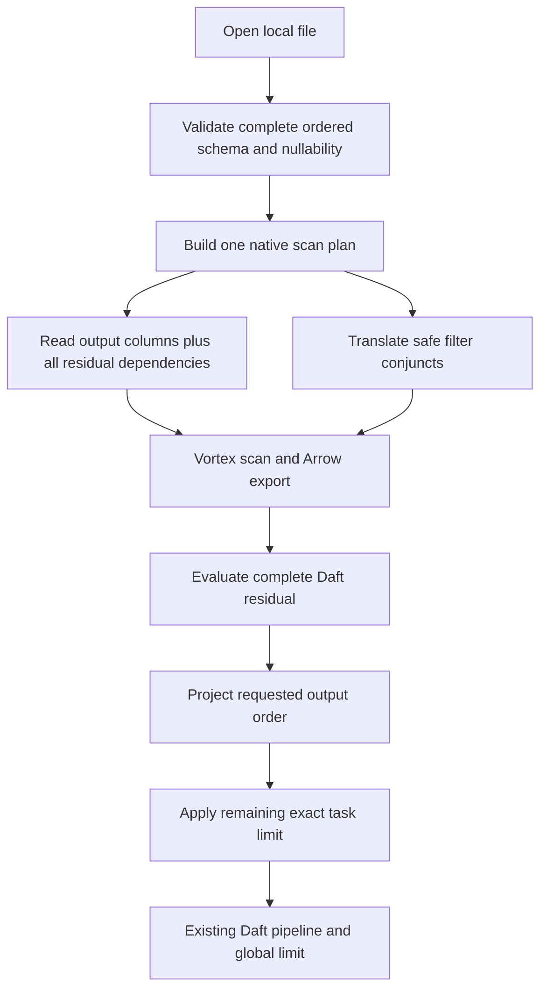

# Vortex Phase 2: selective scans and safe predicate pushdown

**Scope:** the experimental `AYUSHNSUT/Daft` fork only.

**Branch:** `poc/vortex-phase2`, based on Phase 1 commit `8b59043e774005ec223a55fa1e02086aa0fab54a`.

**Delivery:** complete implementation and acceptance checks before opening a draft PR targeting `poc/vortex-phase1`. Do not merge earlier phases or submit upstream as part of this work.

**Status:** implemented and validated. This plan was written before Phase 2 code changes; the [completion record](vortex-phase2-results.md) lists executed checks, observed request-byte reductions, and remaining limits.

## Why this phase exists

[Phase 1](vortex-phase1-results.md) establishes correct native local reads, strict file-schema validation, filtering, projection, limits, and reader ownership. It still reads and exports every physical column, then evaluates the complete filter in Daft. A query selecting two columns from a wide file pays conversion and potentially read costs for unrelated columns. A selective filter also reaches Daft only after Arrow materialization.

Phase 2 moves necessary column selection and a deliberately small filter subset into Vortex. Daft keeps responsibility for complete query semantics. The goal is observable selective work with identical results; faster end-to-end queries remain a hypothesis until measured in the later performance phase.

## Deliverables and boundaries

| Deliverable | Acceptance evidence |
| --- | --- |
| Physical column projection | Unused column payload ranges are not requested in an instrumented, column-separated file |
| Conservative predicate translation | Accepted predicates run in Vortex; unsupported expressions retain a complete Daft fallback |
| Correct residual dependencies | Filter-only columns remain available even when absent from the requested output |
| Exact ordering and limits | Residual evaluation precedes final projection and task limits; outer global limits remain correct |
| Independent optimization switches | Projection and filtering can each be disabled for differential testing |
| Shared native scan diagnostics | Actual read columns and translated predicates are distinguishable from requested flags and logical filters |
| Regression protection | Phase 1 types, schemas, cardinality, lifecycle, default-off builds, and existing reader regressions remain covered |

Keep Vortex 0.88.0 and the existing Arrow boundary. No new cloud support, Ray support, schema evolution, temporal/nested types, writers, metadata counts, intra-file splitting, or Vortex-encoded downstream Daft operators are introduced.

The fork owner has accepted the existing experimental dependency cost. This phase should not need a new dependency family or a change to the repository's dependency-budget check.

## Public API and task configuration

Preserve existing positional arguments and add keyword-only switches:

```python
def read_vortex(
    path,
    io_config=None,
    batch_size=131072,
    *,
    enable_projection_pushdown=True,
    enable_filter_pushdown=True,
): ...
```

Both switches require actual booleans. Their defaults enable the tested Phase 2 paths. Turning both off reproduces Phase 1's physical scan strategy while preserving the same final query semantics:

```python
import daft
from daft import col

optimized = daft.read_vortex("data/*.vortex")
baseline = daft.read_vortex(
    "data/*.vortex",
    enable_projection_pushdown=False,
    enable_filter_pushdown=False,
)

def query(df):
    return df.where(col("value") >= 20).select("id").limit(100)

assert query(optimized).to_pydict() == query(baseline).to_pydict()
```

Carry both switches through `VortexSource`, serializable `VortexSourceConfig`, and `VortexReadOptions`. Config display must show requested settings. Recreate equivalent tasks after source/config serialization; open sessions and live handles remain worker-local.

The switches control physical Vortex optimization, not whether Daft honors a logical filter or projection. Disabling filter pushdown must never disable filtering itself.

## Existing planner integration

Inspection and a real Phase 1 query establish that the current physical-source optimizer already sends `Pushdowns.columns`, `Pushdowns.filters`, and task limits to `VortexSource.get_tasks()`. The generic wrapper's `can_absorb_filter/select` flags are not the controlling checks on this path.

Do not add global capability flags or change other sources to make Vortex work. Keep the existing limit absorption behavior and `supports_count_pushdown()` false. Tests must observe the actual task requirements in public DataFrame queries; direct-reader tests alone cannot establish end-to-end optimizer integration.

## Scan algorithm



### Validate before optimizing

Retain Phase 1's full first-file scan schema and reserved nullability metadata. Validate every executed file's complete ordered field names, types, and nullability before projection, filtering, or a zero task limit. A mismatch in an unused column must still fail.

Maintain separate full-source, physical-read, and final-output schemas. Remove private source-nullability metadata from all materialized output schemas, including empty results. Unknown statistics remain unknown.

### Compute physical columns

1. Resolve requested output columns against the full schema. With no output projection, use all source columns. Preserve explicit output order and zero-column requests.
2. Normalize and inspect the complete Daft residual expression, including bound, resolved, and unresolved column forms supported by the scan contract.
3. If projection pushdown is enabled, read the union of output columns and every residual dependency. Use source order for a deterministic physical schema; reorder only in the final output step.
4. If projection pushdown is disabled, read every physical column.
5. Bind Vortex projection expressions against the full file dtype. Export the selected physical Arrow schema, preserving string/binary view normalization.

Do not rely solely on `get_required_columns()`: in this checkout it does not cover every bound/unresolved column representation. Existing bound Daft column indices also cannot be reused unchanged after columns are removed. Normalize to validated source names or explicitly remap indices, then bind the complete residual to the physical-read schema.

Zero physical columns are valid when neither output nor the residual needs data columns. Preserve Vortex's explicit batch row count through Arrow and the Daft zero-column constructor. Keep counts as ordinary queries over that batch stream, with `supports_count_pushdown()` false; do not add a separate source metadata-count shortcut or invent a value column to hide a cardinality bug. Vortex can derive zero-column batch cardinality without reading payloads, so a count query is not a scan-throughput measurement.

### Translate a small filter subset

| Daft expression | Initial treatment |
| --- | --- |
| Direct integer column compared with a non-null literal of the exact same integer type | Translate `==`, `!=`, `<`, `<=`, `>`, `>=`; support the reversed literal/column form |
| Direct Boolean column compared with a non-null Boolean literal | Translate equality/inequality if differential tests establish the same behavior |
| Direct flat-column null / not-null check | Translate after testing null-only, mixed-null, and non-nullable cases |
| `AND` | Extract independently safe conjuncts, recursively; retain the complete original Daft residual |
| `OR`, `NOT` | Keep the entire subtree in Daft, including fully supported-looking children in this first implementation |
| Mixed integer types, signed/unsigned promotion, casts, floats, arithmetic, UDFs, complex expressions | Complete Daft fallback |
| Null literals in ordinary comparisons | Complete Daft fallback; use explicit null predicates instead |

Exact types matter. In particular, this Daft version promotes mixed Int64/UInt64 comparisons through Float64. Replacing that behavior with an exact-integer Vortex comparison can incorrectly discard rows near the 2^53 boundary. Do not cast a literal merely because it fits the source type, strip an explicit column cast, or assume SQL coercion rules from a different engine.

Bind translated expressions against the full file dtype. Preserve their semantics without rewriting unsupported subtrees. If translation is unsupported, report the fallback and continue with the complete Daft residual. Unknown columns and invalid source expressions remain actionable errors rather than silent optimization fallbacks.

Always reevaluate the complete original predicate in Daft after Vortex filtering. This admits redundant work but prevents unsupported or partially translated expressions from losing semantics. A pushed conjunct may admit extra rows; it must never reject a row that the Daft predicate would keep.

### Keep limits after residual filtering

Do not push any limit into Vortex in Phase 2. The pinned scan builder rejects filter-plus-limit, and an unsupported residual still makes an early limit incorrect even when no Vortex filter was translated.

Enforce the remaining task limit after the complete Daft residual and final projection. Release the stream at the exact limit, without waiting for another consumer poll. Keep the existing global query limit across files and preserve the distinct semantics of `filter().limit()` and `limit().filter()`.

## Diagnostics and evidence

Create one native scan-plan representation reused by execution and diagnostics. It should contain:

- Requested output columns and actual physical-read columns.
- Accepted Vortex predicate, or no translated predicate.
- Complete retained Daft residual.
- Projection/filter optimization flags and useful fallback reasons.

Expose a narrow internal Python binding such as `_vortex_scan_diagnostics` for structured inspection and tests, using the same planner as execution. Keep it behind the native feature, and annotate it in the native stub. Existing task/config display should show requested flags without claiming that an enabled flag means a particular filter was translated or data was pruned.

Do not introduce Python callbacks per batch, global mutable counters, a separate Python expression translator, or a duplicate planner just for explain output. Logical plan text alone is not proof of reduced physical work.

### Projection fixture

Write real Vortex files with a top-level struct whose fields have independent chunked/flat leaf layouts. Include narrow integer/filter columns and a wide unused payload. Supply the writer footer and disable read coalescing in a test-only positional-reader adapter so unused payload requests cannot be hidden by the opener's initial cache or merged reads.

Record requested `(offset, length)` ranges and completed request bytes. Compare identical queries with projection on/off. Assert equal rows/schema and no reads of excluded column payload segments when projection is enabled. Cover reordered output and filter-only columns.

### Filter/pruning fixture

Use clustered, disjoint integer ranges with explicit zone metadata and separate column payload segments. Disable whole-file statistics in the zone-specific test so observed reductions can be attributed to zone pruning. Allow reads of metadata/statistics while asserting that excluded zones' payload ranges are absent.

Compare filter on/off with identical projection settings at 0%, selective, and 100% matches. Also cover null-only/mixed zones. Verify equal results and lower payload reading where the layout makes pruning possible. A non-zoned fixture should demonstrate that filter translation alone does not guarantee fewer bytes read.

The adapter observes software request ranges, not disk-device I/O. Footer caching, normal coalescing, and filesystem caching affect production reads. Do not turn fixture measurements into a universal byte-count or speedup promise.

## Test matrix

| Area | Cases |
| --- | --- |
| Projection | All, one, several, reordered, duplicate/invalid names according to existing API rules, empty output, zero-field files |
| Dependencies | Output excludes filter column; nested `AND`; unsupported subtree references additional columns; bound-index remapping |
| Supported filters | Every accepted operator, reversed operands, exact integer types, signed/unsigned boundaries, Boolean literals, null checks |
| Safe fallback | Mixed Int64/UInt64 around 2^53 and extremes, floats/NaNs/signed zero, casts, arithmetic, UDFs, `OR`, `NOT` |
| Filtering | No matches, selective matches, all matches; independent in-memory expected results and optimization-disabled comparison |
| Limits | 0, 1, batch boundaries, more than total; late matches; filter/limit operator order; multiple files |
| Schema | Projected-away name/type/nullability mismatches, private metadata removal, empty result schemas |
| Public plans | Actual task receives required columns/filter; joins followed by select/group-by; count/literal projections |
| Configuration | Four flag combinations, actual bool validation, source/config pickle, unchanged behavior for other sources |
| Observability | Shared diagnostic plan matches execution; separate payload-range evidence for projection and pruning |
| Lifecycle | Existing real-I/O EOF/limit/drop/error/pending-cancel/concurrent-file tests still pass with optimized scans |
| Feature separation | Enabled build runs all claimed native tests; disabled import/collection stays safe and reports enablement errors |

Use small deterministic generated files. Property-style parameterization is welcome where it catches coercion and null edge cases, but no public buckets, cloud credentials, model downloads, or timing-sensitive sleeps belong in the new acceptance tests.

## Implementation sequence

1. **Native scan planning:** full-schema validation, residual dependency collection/remapping, physical projection, safe filter translator, shared diagnostics, and independent switches.
2. **Wiring and API:** task/config serialization, executor options, keyword-only Python flags, type stubs, requested-setting display, and feature-off behavior.
3. **Proof of selective work:** real column-separated and zone-pruning fixtures with recorded request ranges; differential native tests.
4. **Public end-to-end verification:** DataFrame filter/select/limit, joins and aggregations, all flag combinations, safe fallbacks, and diagnostics.
5. **Regression and closure:** rebuild, run targeted Rust and Python suites, preserve lifecycle tests, check both feature configurations, run contribution hooks, record results, commit, push, and only then open the fork PR.

Keep implementation below `daft-scan` in the dependency graph. Coordinate the reader, wiring, and Python work around the same option names. Preserve unrelated local files. Do not change the existing global source flags, dependency-budget policy, or shared executor buffering to finish this phase.

## Validation commands

Run from the repository root after normal development setup. Offline commands require the already cached dependencies.

```bash
# Pure Rust reader behavior, including translation and real-I/O evidence.
CARGO_BUILD_JOBS=2 cargo test --offline --locked --no-default-features -p daft-vortex

# Rebuild the native extension after Rust changes.
env -u CONDA_PREFIX CARGO_BUILD_JOBS=2 PYO3_PYTHON=.venv/bin/python \
  DAFT_DASHBOARD_SKIP_BUILD=1 .venv/bin/maturin develop \
  --skip-install --offline --locked --features python,vortex

# New and existing local connector coverage.
DAFT_RUNNER=native DAFT_PROGRESS_BAR=0 .venv/bin/pytest -n 0 -rs \
  tests/io/test_vortex.py tests/io/test_vortex_native_tasks.py \
  tests/io/test_vortex_lifecycle.py tests/io/test_vortex_pushdowns.py \
  tests/io/test_native_tasks.py tests/io/test_datasource_join.py \
  tests/io/test_parquet.py tests/dataframe/test_count.py examples/vortex_eval

# Reader linting; repository pre-commit also runs the broader Rust configuration.
CARGO_BUILD_JOBS=2 cargo clippy --offline --locked --no-default-features \
  -p daft-vortex --all-targets --no-deps -- -D warnings
```

Also rebuild without `vortex`, run the feature-off reader tests, restore the enabled extension, and validate ordinary Daft queries. Run applicable pre-commit hooks with `DAFT_DASHBOARD_SKIP_BUILD=1` when the environment cannot build dashboard assets. Keep full-workspace or external-service checks distinct from focused local acceptance.

## Closure criteria

Phase 2 closes only when:

1. Optimized/unoptimized results agree with the independent oracle for the declared expression and type matrix.
2. Real request-range evidence demonstrates column exclusion and zone pruning on suitable fixtures.
3. Unsupported expressions fall back without false negatives, and residual dependencies, zero-column cardinality, schema validation, and exact limits remain correct.
4. Public DataFrame queries exercise the native optimization path; diagnostics describe the actual scan plan.
5. Phase 1 regression/lifecycle checks, builds with the feature on/off, and applicable static checks pass, or any external restriction is recorded separately.
6. A completion report records actual commands/results, measured fixture work, support limits, and any dependency change. The fork PR is opened after these checks finish.

Hard query-memory bounds, immediate cancellation of running OS reads, and prompt end-to-end query cancellation remain the explicit Phase 3 responsibilities established in Phase 1. This phase does not relabel them as completed.

Material AI assistance is used for this fork's design, implementation, and tests. The completion record will state what was actually verified.
